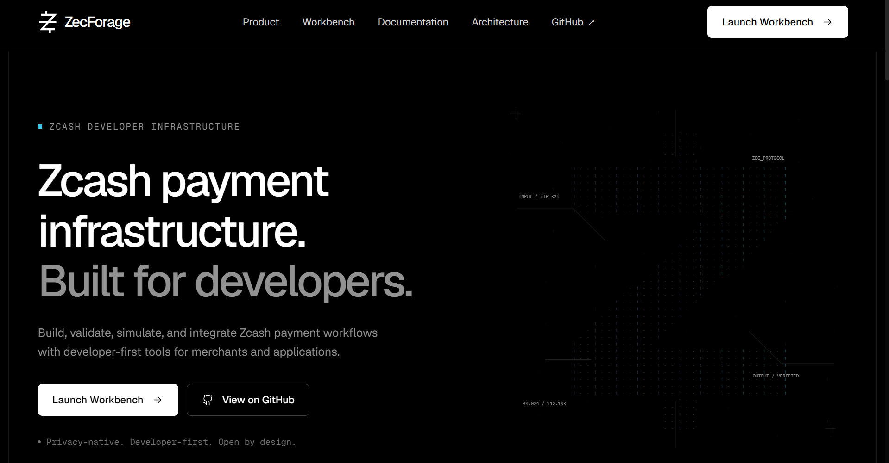
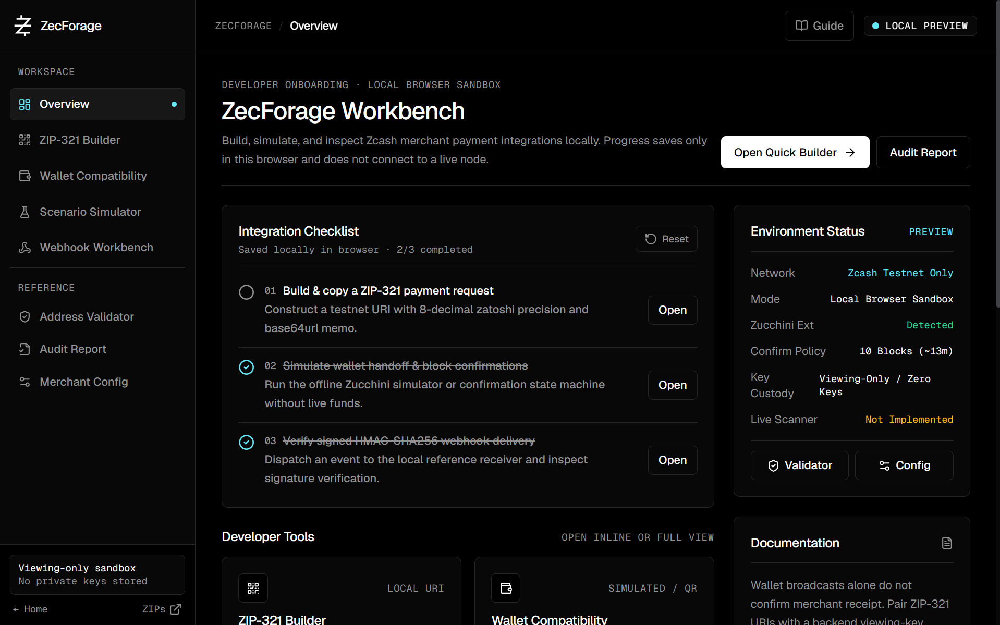
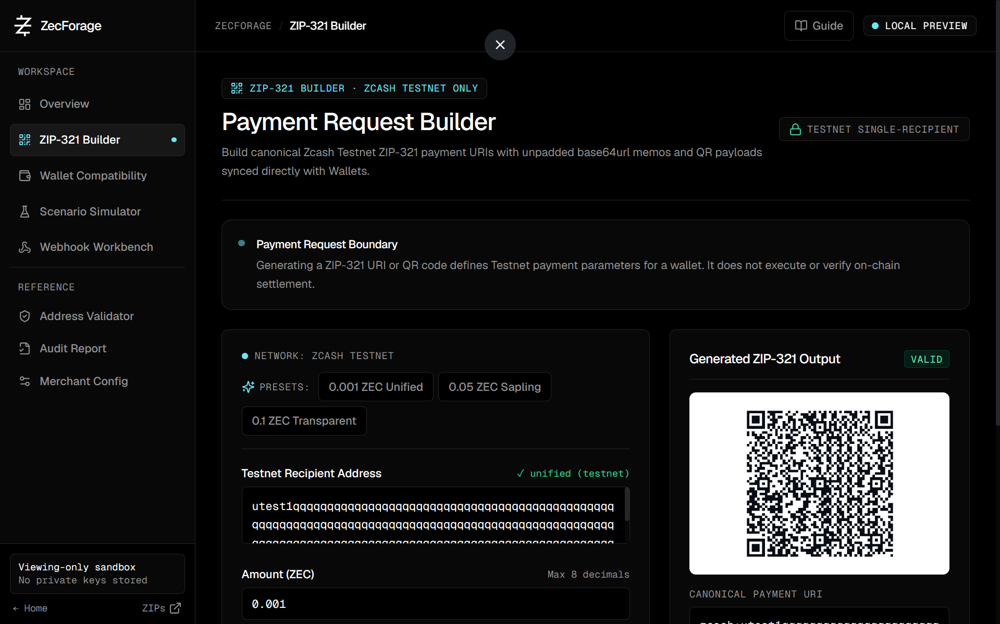
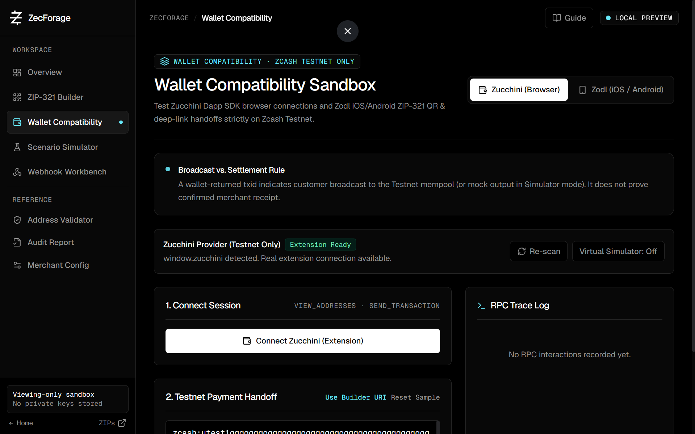
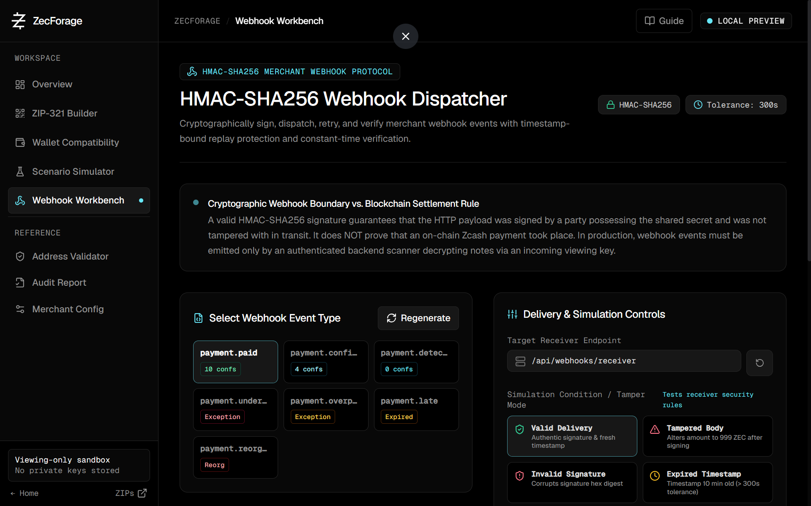

<h1 align="center">
  
</h1>

<div align="center">
  
  
</div>

<br />

<div align="center">
  <strong>The developer workbench for Zcash shielded payment integrations.</strong>
</div>

<p align="center">
  ZecForage is an open-source Testnet-only developer workbench for designing, validating, simulating, and verifying Zcash merchant payment flows before building production infrastructure. Build ZIP-321 payment requests, test wallet handoffs, replay edge-case settlement scenarios, and verify HMAC-signed webhook delivery — all locally, all honestly labelled.
  <br /><br />
  <a href="#-application-interface"><strong>📸 Screenshots</strong></a>
  &nbsp;·&nbsp;
  <a href="#-getting-started"><strong>🚀 Quick Start</strong></a>
  &nbsp;·&nbsp;
  <a href="#-architecture--call-flow"><strong>🏗 Architecture</strong></a>
</p>

---

## ⚡ What is ZecForage?

**ZecForage is a developer integration workbench — not a cryptocurrency wallet, custody service, or production payment processor.**

Shielded Zcash checkout integrations require strict protocol boundaries and deterministic edge-case handling before any mainnet integration:

1. **Merchant Settlement Boundary Rule:** A customer wallet broadcast (`txid`) does **not** equal confirmed merchant receipt. Note decryption must occur independently on a merchant backend via an incoming viewing key (IVK) scanner with canonical block confirmation accumulation.
2. **ZIP-321 Constraints:** Payment URIs must enforce max 8-decimal ZEC amounts (`BigInt` zatoshis), unpadded `base64url` memo encoding (`<= 512` bytes), Testnet address prefix validation, and strict rejection of shielded memos on transparent (`tm` / `t2`) addresses.
3. **Dual Wallet Modalities:** Browser extensions (**Zucchini Wallet** via `@zucchinifi/dapp-sdk`) and mobile wallets (**Zodl**, formerly Zashi) operate differently — desktop EIP-1193 RPC injection vs. air-gapped ZIP-321 QR scanning and `zcash:` deep links on iOS/Android Testnet builds.
4. **Exception Precedence:** Underpayments, overpayments, late post-expiry arrivals, and chain reorganizations must permanently block automated fulfillment (`canFulfill: false`) regardless of accumulated confirmation depth.
5. **Authenticated Webhooks:** Webhook consumers must verify raw-body HMAC-SHA256 signatures in constant time (`crypto.timingSafeEqual`), enforce timestamp replay tolerances, and handle duplicate deliveries idempotently.

ZecForage provides an isolated, **Testnet-only** browser sandbox and reference local API routes to inspect and test every stage of this workflow.

---

## 🗺 Verification & Simulation Matrix

| Feature / Route | Classification | Scope & Notes |
|---|---|---|
| 🌐 **Landing Page (`/`)** | ✅ Verified (UI) | Full-width black/cyan Next.js landing page with inline local previews and direct workbench entry. |
| 🏠 **Onboarding Dashboard (`/dashboard`)** | ✅ Verified (Local Browser) | Compact workspace, browser-local 3-step onboarding checklist, 2×2 inline developer tool launcher, real session activity log, and live extension detection. |
| 🛡️ **Address Validator (`/validator`)** | ⚠️ Partial (Format-Only) | Validates Testnet prefixes (`utest1`, `ztestsapling1`, `tm`, `t2`), Bech32/Base58 character sets, lengths, and Mainnet mismatch rejection. Does **not** verify checksums or curve points. |
| 📦 **ZIP-321 Builder (`/builder`)** | ✅ Verified (Local) | Generates canonical Testnet `zcash:` URIs, `BigInt` zatoshis, unpadded `base64url` memos, high-contrast QR PNGs, Copy/Download controls, and syncs latest URI to `/wallets`. |
| 👛 **Wallet Compatibility (`/wallets`)** | 🔵 Simulated (Zucchini Virtual) / Manual (Zodl QR) | Supports real `window.zucchini` EIP-1193 discovery plus an explicit Virtual Simulator (mock txids). Zodl iOS/Android generates Testnet QR/deep links and saves manual device verification logs locally. |
| 🧪 **Scenario Simulator (`/scenarios`)** | 🔵 Simulated (Offline FSM) | Deterministic 8-state reconciliation engine synced with `/settings` confirmation threshold (`BigInt` zatoshi accounting). Zero blockchain node connection. |
| 🔔 **Webhook Workbench (`/webhooks` & `/api/webhooks/*`)** | ✅ Verified (Local Loopback API) | Server-side HMAC-SHA256 signing, constant-time verification, raw body check, `300s` replay window, `5xx` bounded retries, SSRF guard, and process-local in-memory idempotency. |
| 📊 **Integration Audit Report (`/reports`)** | ✅ Verified (Local) | Aggregates unit test baseline (`111/111`), local confirmation policy, and recorded Zodl device runs into `.md` and `.json` exports. Always marks on-chain verification `NOT_VERIFIED` and `productionReady: false`. |
| ⚙️ **Merchant Config Hub (`/settings`)** | 🔵 Simulated / Reference Only | Stores local Testnet lightwalletd RPC endpoint references (`host:port` validated), syncs confirmation threshold (`1–50` blocks) to `/scenarios` & `/reports`, and provides Express, Next.js, and FastAPI HMAC receiver templates. |

---

## 📸 Application Interface

| Landing Page | Developer Onboarding Dashboard |
| :---: | :---: |
|  |  |
| **ZIP-321 Payment Request Builder** | **Wallet Compatibility Sandbox (Zucchini & Zodl)** |
|  |  |

<div align="center">
  <br />
  <strong>HMAC-SHA256 Webhook Workbench & Replay Verification</strong>
  <br /><br />
  
</div>

---

## 🏗 Architecture & Call Flow

```text
┌──────────────────────────────────────────────────────────────────┐
│          Developer Browser Sandbox (Next.js 14 App Router)       │
│   (marketing) route group    │    (workbench) route group        │
│         Landing Page /       │  /dashboard /builder /validator   │
│                              │  /wallets /scenarios /webhooks    │
│                              │  /reports  /settings              │
└──────────────┬───────────────┴──────────────────────────────────┘
               │
               │  (1) Build Canonical Testnet ZIP-321 URI
               ▼
┌──────────────────────────────────────────────────────────────────┐
│                     Wallet Sandbox (/wallets)                    │
│   Browser: @zucchinifi/dapp-sdk  │  Mobile: Zodl iOS/Android    │
│   (window.zucchini or Simulator) │  (zcash: deep link / QR)     │
└──────────────┬───────────────────────────────────────────────────┘
               │  (2) Customer Signs & Broadcasts
               │      (or Virtual Simulator emits mock txid)
               ▼
┌──────────────────────────────────────────────────────────────────┐
│          Scenario State Machine (/scenarios — Offline FSM)       │
│  awaiting_payment → detected → confirming → paid                 │
│  underpaid │ overpaid │ late_payment │ reorg_review              │
│  (3) Validates Exact Amount, Expiry Window & Confirmation Policy │
└──────────────┬───────────────────────────────────────────────────┘
               │  (4) Verifies t={unix_s},v1={hex} over
               │      "${ts}.${rawBody}" with timingSafeEqual
               ▼
┌──────────────────────────────────────────────────────────────────┐
│   HMAC-SHA256 Webhook Loopback                                   │
│   POST /api/webhooks/dispatch  →  POST /api/webhooks/receiver    │
│   SSRF guard  │  300s replay  │  in-memory idempotency  │ 5xx retry│
└──────────────┬───────────────────────────────────────────────────┘
               │  (5) Export
               ▼
┌──────────────────────────────────────────────────────────────────┐
│          Compliance Audit Export (/reports → .md / .json)        │
│          productionReady: false │ 111/111 unit test baseline     │
└──────────────────────────────────────────────────────────────────┘
```

**Inter-Module Data Flow:**
1. **Build:** `Builder` generates ZIP-321 URI → auto-synced to `Wallets` via `localStorage` custom event
2. **Connect:** `Wallets` discovers `window.zucchini` or falls back to Virtual Simulator; requests Testnet payment
3. **Simulate:** `Scenarios` replays FSM states with BigInt zatoshi precision; threshold synced from `Settings`
4. **Dispatch:** `Webhooks` signs payload server-side → delivers to local receiver → HMAC verified in constant time
5. **Report:** `Reports` aggregates live store state into audit-ready Markdown/JSON export

---

## ⚡ Core Features

- 🔐 **ZIP-321 Payment Builder** — Canonical `zcash:` URI generation with `BigInt` zatoshi precision, unpadded `base64url` memos, and downloadable high-contrast QR PNGs.
- 🛡️ **Testnet Address Validator** — Structural prefix/charset/length inspection for unified (`utest1`), Sapling (`ztestsapling1`), and transparent (`tm`/`t2`) Testnet addresses.
- 👛 **Dual Wallet Compatibility** — Zucchini Dapp SDK browser integration (real `window.zucchini` or Virtual Simulator) plus Zodl iOS/Android air-gapped QR/deep-link workflows.
- 🧪 **8-State Payment FSM** — Deterministic scenario simulator with sticky exception precedence: underpaid, overpaid, late, and chain-reorg states permanently block `canFulfill`.
- 🔔 **HMAC-SHA256 Webhook Workbench** — Server-side signing, constant-time `timingSafeEqual` verification, 300s replay protection, SSRF guard, 5xx bounded retries, and in-memory idempotency.
- 📊 **Integration Audit Report** — Live-state `.md`/`.json` export aggregating test baseline, Zodl device runs, and confirmation policy. Always marks on-chain verification `NOT_VERIFIED`.
- ⚙️ **Merchant Config Hub** — Testnet lightwalletd RPC endpoint manager, confirmation threshold slider (1–50 blocks), and copy-ready Express/Next.js/FastAPI webhook receiver templates.
- 🔒 **Privacy-First Architecture** — Zero private keys, zero external node connections, zero fabricated balances. All state is browser-local `localStorage`.
- ♻️ **Cross-Module State Sync** — Builder→Wallets URI sync, Settings→Scenarios threshold sync, all via `zecforage:state-updated` custom event without page reloads.

---

## 🔒 Core Security Invariants

| Invariant | Detail |
|---|---|
| 🔐 **Testnet-Only Lockdown** | All UI address validators, URI builders, wallet dispatch guards, and RPC preset lists are scoped exclusively to Zcash Testnet |
| 🚫 **Zero Private Key Ingestion** | Never collects, stores, or logs spending keys, seed phrases, or viewing keys |
| 🗃️ **Honest Local State** | Onboarding checklists, settings, and activity logs persist strictly in browser `localStorage`; never sent to external parties |
| 🔑 **Server-Only Webhook Secret** | `ZECFORGE_WEBHOOK_SECRET` is accessed solely in Next.js server routes via `process.env` and never exposed to client bundles |
| ⏱️ **Replay Protection** | Webhook signatures include `t={unix_seconds}` and are rejected if `age > 300s` or timestamp is `> 5s` in the future |
| ⚡ **Constant-Time Verification** | `crypto.timingSafeEqual()` prevents timing side-channel attacks on HMAC comparison |
| 🛡️ **SSRF Guard** | Dispatch endpoint blocks `169.254.169.254`, `metadata.google.internal`, protocol-relative URLs, and non-http(s) schemes |

---

## 🛠 Tech Stack

| Domain | Technology |
|---|---|
| 🏗️ **Framework** | Next.js 14 (App Router with `(marketing)` and `(workbench)` route groups) |
| 💻 **Language** | TypeScript 5 (`strict: true`) |
| 🎨 **Styling & Typography** | Tailwind CSS 3 (`#000000` canvas, `#080808` cards, `#262626` borders, `#35C9E8` cyan), Geist & Geist Mono fonts |
| 🎯 **Icons** | Lucide React (`16–20px`, `1.5px` stroke width) |
| 🔗 **Zcash SDK** | `@zucchinifi/dapp-sdk` `0.2.0` (Zucchini Wallet EIP-1193 provider) |
| ✅ **Validation** | Zod (schema-first, with `safeParse` throughout) |
| 📷 **QR Codes** | `qrcode` library (high-contrast PNG, 300–320px) |
| 🧪 **Testing** | Vitest (`111` unit tests, `8` suites, `strict` TypeScript) |
| 🔍 **Linting** | ESLint (`next/core-web-vitals`), `npx tsc --noEmit` |
| 🔐 **Cryptography** | Node.js `crypto` (`createHmac`, `timingSafeEqual`) |

---

## 🧪 Testing & Validation

All protocol logic, Zcash address rules, ZIP-321 encoding, FSM transitions, and webhook security are covered by unit tests.

| Test Suite | Tests | Focus |
|---|:---:|---|
| `test/addresses.test.ts` | 9 | Prefix, charset, whitespace, transparent/sprout warnings, network mismatch |
| `test/zip321.test.ts` | 11 | Zatoshi `BigInt` precision, 512B base64url memos, SDK round-trip & network mismatch |
| `test/wallet.test.ts` | 6 | Virtual Zucchini EIP-1193 provider contract, connect, requestPayment, disconnect |
| `test/zodl.test.ts` | 8 | Zodl QR/deep-link parameter construction & manual audit record builder |
| `test/scenarios.test.ts` | 11 | 8-state FSM, sticky exception precedence, reorg drop/recovery, reset |
| `test/webhooks.test.ts` | 26 | HMAC-SHA256 signing, tamper detection, replay window, idempotency, retries |
| `test/reports.test.ts` | 9 | Audit report tier classification, JSON/Markdown exports, secret exclusion |
| `test/settings.test.ts` | 31 | Confirmation risk policy, RPC presets, Express/Next.js/FastAPI templates |
| **Total** | **111/111** | ✅ **100% Passing** |

---

## 🚀 Getting Started

### Prerequisites

- **Node.js** `>= 20` (tested on Node `v22` / `v24`)
- **npm**

### 1. Clone & Install

```bash
git clone https://github.com/yashannadate/ZecForage.git
cd ZecForage
npm install
```

### 2. Environment Setup

Copy the example environment file for server-side webhook signing:

```bash
cp .env.example .env.local
```

| Variable | Description | Default |
|---|---|---|
| `ZECFORGE_WEBHOOK_SECRET` | Server-side HMAC-SHA256 webhook signing secret (32+ byte hex recommended). Never prefix with `NEXT_PUBLIC_`. | Development fallback secret when unset |
| `ZECFORGE_CONFIRMATION_THRESHOLD` | Reference confirmation threshold documented for backend templates. | `10` |

### 3. Run Locally

```bash
npm run dev
```

Open [http://localhost:3000](http://localhost:3000) for the landing page, or [http://localhost:3000/dashboard](http://localhost:3000/dashboard) for the Developer Onboarding Workbench.

### 4. Verification Commands

```bash
# Run all 111 Vitest unit tests across 8 test suites
npm test

# Lint codebase
npm run lint

# Build production bundle (12 App Router routes)
npm run build

# Strict TypeScript check
npx tsc --noEmit
```

---

## 📁 Project Structure

```text
ZecForage/
├── .env.example                              # Environment variable reference
├── .eslintrc.json                            # ESLint config
├── LICENSE                                   # MIT License
├── README.md
├── tailwind.config.ts                        # Tailwind CSS v3 config
├── public/
│   ├── favicon.png                           # Favicon icon
│   ├── logo.png                              # ZecForage official logo
│   └── screenshots/                          # Application interface screenshots
│       ├── landing.png
│       ├── workbench.png
│       ├── ZIP.png
│       ├── wallet-compatiblility.png
│       └── webhook.png
├── src/
│   ├── app/
│   │   ├── (marketing)/                      # Public landing page route group
│   │   │   ├── layout.tsx
│   │   │   └── page.tsx                      # Landing page with inline SVG art
│   │   ├── (workbench)/                      # Developer workbench route group
│   │   │   ├── layout.tsx                    # Workbench shell (sidebar + header)
│   │   │   ├── dashboard/page.tsx            # Onboarding hub + tool grid
│   │   │   ├── validator/page.tsx            # Address validator (Testnet-only)
│   │   │   ├── builder/page.tsx              # ZIP-321 URI builder + QR
│   │   │   ├── wallets/page.tsx              # Zucchini + Zodl compatibility
│   │   │   ├── scenarios/page.tsx            # 8-state payment FSM simulator
│   │   │   ├── webhooks/page.tsx             # HMAC webhook workbench
│   │   │   ├── reports/page.tsx              # Integration audit report
│   │   │   └── settings/page.tsx             # Merchant config hub
│   │   ├── api/webhooks/
│   │   │   ├── dispatch/route.ts             # POST: sign & dispatch webhook
│   │   │   └── receiver/route.ts             # GET/POST: verify & process webhook
│   │   └── globals.css                       # Geist fonts, animations, reduced-motion
│   ├── components/
│   │   ├── dashboard/InlineToolWorkspace.tsx # Inline 4-tool panel for dashboard
│   │   ├── layout/
│   │   │   ├── AppShell.tsx                  # Root layout shell
│   │   │   ├── Header.tsx                    # Breadcrumb + Local Preview badge
│   │   │   └── Sidebar.tsx                   # Compact 5-item workbench nav
│   │   └── ui/
│   │       ├── PageHeader.tsx                # Reusable page header component
│   │       └── SettlementRuleAlert.tsx       # Broadcast-vs-settlement warning
│   └── lib/
│       ├── zcash/
│       │   ├── addresses.ts                  # Structural address inspection
│       │   ├── zip321.ts                     # ZIP-321 URI builder + parser
│       │   ├── wallet.ts                     # Zucchini SDK + virtual provider
│       │   ├── zodl.ts                       # Zodl QR/deep-link generation
│       │   ├── scenarios.ts                  # 8-state payment FSM
│       │   └── webhooks.ts                   # HMAC-SHA256 + idempotency store
│       ├── reports/generator.ts              # Integration audit report generator
│       └── settings/
│           ├── store.ts                      # localStorage state with custom events
│           └── types.ts                      # RPC presets, templates, threshold constants
└── test/                                     # 8 Vitest test suites (111 tests)
    ├── addresses.test.ts
    ├── zip321.test.ts
    ├── wallet.test.ts
    ├── zodl.test.ts
    ├── scenarios.test.ts
    ├── webhooks.test.ts
    ├── reports.test.ts
    └── settings.test.ts
```

---

## ⚠️ Known Limitations

1. 🔌 **No Live Blockchain / Lightwalletd Scanner:** ZecForage does not connect to `lightwalletd` gRPC endpoints or perform incoming viewing key (IVK) trial decryption on compact blocks.
2. 🔍 **Structural Address Checks Only:** Prefix, length, and Bech32/Base58 character checks run client-side; polynomial checksum verification and Pallas/Jubjub curve decompression require native Zcash cryptography.
3. 👤 **Single-Recipient ZIP-321 Subset:** Multi-recipient indexed parameters (`?address.1=...`) are rejected per the Zucchini 0.5.2 single-recipient profile.
4. 🗃️ **In-Memory Server Deduplication:** `/api/webhooks/receiver` uses a process-local `InMemoryIdempotencyStore` (not persisted across server restarts; use Redis or SQL unique constraints in production).
5. 🧪 **Simulated Wallet & Testnet-Only Defaults:** Virtual Zucchini mode returns mock 64-char hex transaction IDs; real wallet signing requires the Zucchini browser extension on Testnet or a Zodl iOS/Android Testnet developer build.

---

## 🏆 Zcash India Build on Zcash Bounty — November 2026

ZecForage was built for the **Zcash India Build on Zcash Bounty (November 2026)**.

| Requirement | Status |
|---|---|
| ✅ Public GitHub Repository | Done |
| ✅ MIT License | Done — see [`LICENSE`](./LICENSE) |
| ✅ README with problem, features, architecture, setup | Done |
| ✅ Honest simulation vs. verification labelling | Done — in UI, README, and audit reports |
| ✅ Testnet-Only scope | Done — all modules locked to Zcash Testnet |
| ✅ 111/111 unit tests passing | Done |
| ✅ Application Screenshots | Done — 5 interface screenshots included |
| ✅ No API keys or secrets in repository | Done — `.env.example` has placeholder only |

---

## 📄 License

<p align="center">
  <b>Built by Yash Annadate</b> 👨‍💻
  <br /><br />
  Released under the <a href="./LICENSE">MIT License</a>
</p>
